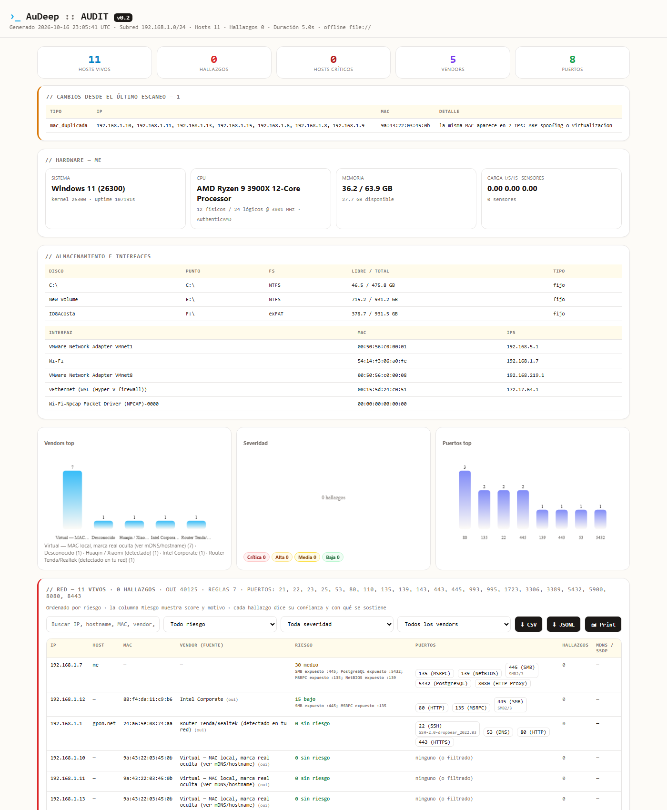

# AuDeep — Auditor de Hardware y Red (Rust) · v0.2

Herramienta offline, portable (USB) y plug&play (Raspberry Pi) para inventario de hardware, descubrimiento de red, escaneo de puertos y detección de vulnerabilidades. Un solo binario estático, sin dependencias en runtime. Proyecto independiente y limpio (el frontend vive en `../audeep-web`).

Lo que la hace distinta de un `nmap` con esteroides: **dice con qué certeza afirma cada cosa y avisa qué cambió** desde el escaneo anterior.



## Novedades v0.2

- **Veredicto de host honesto**: `Probe::Open | Refused | Filtered`. Un RST cuenta como host vivo; un timeout no afirma nada. Se acabó el heurístico de `ping` que leía textos en inglés que en otros idiomas no existen (`network::ping_reply_is_alive` solo acepta `TTL=`).
- **Descubrimiento ARP-first**: barrido UDP que fuerza la resolución ARP de toda la red y después lee la tabla. Es lo que hace que una LAN de 254 hosts se resuelva en segundos y que aparezcan los dispositivos silenciosos (IoT sin puertos abiertos).
- **Subred real por máscara** (`if-addrs`), no `/24` asumido, con techo de hosts y barrido acotado al `/24` propio en redes enormes.
- **Parser ARP multi-formato y validado** (`src/arp.rs`): Windows/Linux, cualquier idioma del campo *Type*, MAC validada y multicast/broadcast descartados.
- **Vendor con fuente**: `oui` (registro), `oui-local` (MAC aleatoria: el OUI **no** identifica a nadie), `hostname`, `mdns`, `ssdp`, `banner`, `puerto`, `http`. Y sin falsos positivos por substring (`contains_token`).
- **Confirmación real de SMBv1** (`src/probe.rs`): se negocia el protocolo en el 445 y se mira qué dialecto acepta el equipo. Solo si acepta SMB1 se marca EternalBlue.
- **SSH por rango de versión**: del banner se extrae producto y versión y se compara contra rangos por aviso (7.0–7.6, 8.0–9.3…), en vez de una lista de substrings.
- **Confianza y evidencia por hallazgo**: `confirmado` / `probable` / `sospecha` + con qué se sostiene (banner, versión, negociación activa).
- **Score de riesgo por host** (`src/risk.rs`): 0-100, nivel y motivos; el reporte se ordena por riesgo y no por IP.
- **Historial con diff y anomalías de capa 2** (`src/history.rs`, SQLite): dispositivos nuevos, desaparecidos, puertos que se abrieron, **la misma MAC en varias IPs** (ARP spoofing o virtualización) y **la MAC del gateway cambiada** (posible MitM).
- **`serve` endurecido**: escucha en loopback por defecto, TTL de caché configurable, token opcional, `ETag`/`304`, cabeceras de seguridad y `/scan` para forzar. Ya no re-escanea la red cada 12 segundos.
- **Config `audeep.json`** con timeouts, puertos y exclusiones.
- **Caché de la base de CVEs** con `OnceLock` (antes se reconstruía en cada host y escribía un SQLite temporal por host).
- **CI**: `cargo fmt --check`, `cargo clippy -D warnings` y `cargo test` en Linux y Windows.

## Uso rápido (Windows)

```pwsh
# Opción simple: toolchain normal, sin zig
cargo build
.\target\debug\audeep.exe            # escanea y escribe los reportes
.\target\debug\audeep.exe --serve    # http://127.0.0.1:8766/

# Opción estática (Linux/USB, requiere zig 0.16 en el PATH + cargo install cargo-zigbuild)
cargo zigbuild --target x86_64-pc-windows-gnu
.\target\x86_64-pc-windows-gnu\debug\audeep.exe
```

Salida por defecto: `audeep_reporte.html`, `audeep_reporte.json` y `audeep_history.db`.

## CLI

| Flag | Qué hace |
|---|---|
| *(nada)* | Hardware + descubrimiento + puertos + CVEs + reportes + historial |
| `--no-scan` | Solo hardware local |
| `--json <PATH>` / `--html <PATH>` | Rutas de salida |
| `--history <PATH>` | Historial SQLite (default `audeep_history.db`) |
| `--no-history` | No guardar ni comparar historial |
| `--config <PATH>` | Config JSON (si no se pasa, usa `audeep.json` cuando existe) |
| `--serve [ADDR]` | Servidor. Default `127.0.0.1:8766`; para el modo AP: `--serve 0.0.0.0:80` |
| `--serve-interval <SECS>` | Validez del reporte cacheado (default 60) |
| `--serve-token <TOKEN>` | Exige `?token=` o `X-Auth-Token` |
| `--help` / `--version` | clap |

## Config `audeep.json`

```json
{
  "probe_timeout_ms": 400,
  "concurrency": 64,
  "mdns_timeout_ms": 1200,
  "ports": [21, 22, 80, 443, 445, 3389],
  "exclude": ["192.168.1.50"]
}
```
Todos los campos son opcionales; se validan y normalizan (puertos ordenados y sin repetidos, timeouts y concurrencia dentro de rango). Ver `audeep.example.json`.

## Cómo decide (y por qué podés confiar)

| Pregunta | Cómo se responde |
|---|---|
| ¿Está vivo? | Barrido ARP (prueba de capa 2 en los últimos segundos) → si no, TCP (abierto **o** RST) → si no, `ping` **solo** si la salida trae `TTL=` |
| ¿Qué puertos? | 21 comunes (o los de la config), banner pasivo solo donde el servicio saluda primero |
| ¿Es SMB1? | Negociación real del protocolo en el 445 (73 bytes, respuesta `\xFFSMB` vs `\xFESMB`) |
| ¿Qué OpenSSH? | Producto + versión del banner contra rangos publicados por aviso |
| ¿Qué tan seguro estoy? | `confirmado` (prueba activa), `probable` (lo declara el equipo), `sospecha` (solo el puerto) |
| ¿Qué cambió? | Diff contra el escaneo anterior en `audeep_history.db` + anomalías L2 |

## Seguridad del modo servidor

- Escucha en **loopback** salvo que le pases una dirección explícita.
- Si lo exponés en la LAN (`--serve 0.0.0.0:8766`), usá `--serve-token` y recordá que el reporte incluye el inventario completo de tu red.
- Salud: `GET /health`. Forzar reescaneo: `GET /scan`. JSON: `GET /json`. Docs: `/docs` y `/docs/conceptos`.

## ¿Dónde corre?

Un solo binario de ~7 MB que en un escaneo completo usa ~38 MB de RAM: **necesita un sistema operativo de verdad**, no un microcontrolador.

| Dónde | ¿Corre? | Nota |
|---|---|---|
| PC o notebook con Windows / Linux | ✅ | El caso normal: `cargo build` y listo |
| Mini-PC o PC vieja | ✅ | Mejor que una Raspberry: más RAM y ya trae pantalla |
| Raspberry Pi, Orange Pi, Banana Pi, Radxa, BeagleBone | ✅ | Hay builds ARM64 y ARMv7 (`scripts/build_rpi.ps1`) |
| NAS (Synology/QNAP x86 o ARM) que permita ejecutar binarios | ✅ | Por SSH |
| Docker | ✅ | `Dockerfile` incluido |
| Android con Termux | ⚠️ probable | Binario ARM64 estático; sin probar |
| Router con OpenWrt | ⚠️ posible | Hay que compilar para su arquitectura y suele ir justo de RAM; sin probar |
| macOS | ⚠️ necesita un ajuste | Lee la tabla ARP con comandos de Windows/Linux: en Mac caería a ping/TCP |
| ESP32, Arduino, STM32 o cualquier microcontrolador | ❌ | Pide ~38 MB de RAM y un sistema operativo: un ESP32 tiene ~320 KB y un Arduino 2 KB |

**Ojo con el USB:** el pendrive **no es la computadora**. Copiás el binario al pendrive y lo ejecutás **en la PC donde lo enchufás**, sin instalar nada. Si querés que el pendrive sea autónomo, se hace un Linux arrancable con AuDeep adentro (live USB): la computadora sigue siendo la PC y el pendrive solo trae el sistema.

## Despliegue en Raspberry Pi / USB / Docker

```bash
powershell -File scripts/build_rpi.ps1          # aarch64 / armv7 / musl 7.2-7.6 MB
scp target/aarch64-unknown-linux-gnu/release/audeep pi@pi:/tmp/
ssh pi@pi 'sudo mv /tmp/audeep /usr/local/bin/ && sudo systemctl enable --now audeep'
sudo audeep-ap on                                # AuDeep-Auditor 192.168.4.1
```

Docker: la imagen final es distroless y **no** trae `ping` ni `arp`, así que el descubrimiento baja a TCP puro; para el modo servidor usá `docker run --rm --network host audeep:latest --serve 0.0.0.0:8766`.

## Estructura

```
src/main.rs      CLI y orquestación
src/hardware.rs  CPU/RAM/discos/interfaces (con IPs) y sensores
src/arp.rs       lectura y parseo multi-formato de la tabla ARP
src/network.rs   barrido ARP-first, subred real, mDNS/SSDP, vendors con fuente
src/scanner.rs   sondeo de 3 estados, banners y puertos activos
src/probe.rs     negociación SMB1 y versiones SSH
src/vuln.rs      base curada + SQLite (OnceLock), reglas y confianza
src/risk.rs      score de riesgo por host
src/history.rs   historial SQLite, diff y anomalías L2
src/report.rs    JSON + HTML offline (riesgo, evidencia, eventos, CSV/JSONL)
src/serve.rs     servidor HTTP con caché, ETag y token
src/config.rs    audeep.json
```

## Tests y CI

`cargo test` corre **55 tests** de unidades sobre lo que importa: parseo de ARP en dos formatos y dos idiomas, matemática de subred, veredicto por TTL, clasificación de errores Winsock, negociación de SMB1, rangos de versión de SSH, reglas de vulnerabilidad, score de riesgo, diff del historial y escaping del reporte. GitHub Actions corre `fmt --check`, `clippy -D warnings` y `test` en Ubuntu y Windows.

## Docs

- `docs/architecture.md` — arquitectura y stack
- `docs/conceptos.md` — referencia técnica con ejemplos reales
- En vivo desde `--serve`: `/docs` (arquitectura), `/docs/guia` (guía simple sin tecnicismos) y `/docs/conceptos` (referencia técnica)
- `deploy/ap/README.md` — modo AP (hostapd + dnsmasq)
